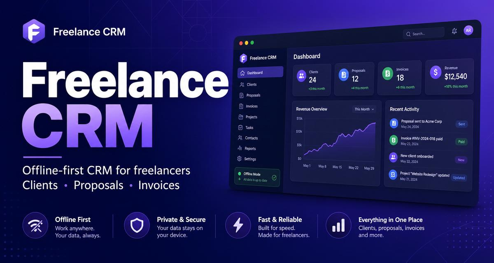

<div align="center">



# Freelance CRM

Keep clients, proposals, interviews, and invoices in one calm, local-first workspace.

[][app]
[][coffee]

[](#requirements)
[](#requirements)
[](LICENSE)

</div>

## About

**Freelance CRM** is a local-first customer relationship manager for freelancers. It brings the messy business side of freelancing — clients, proposals, interviews, invoices, and follow-ups — into one focused app.

It is built with Upwork freelancers in mind, but the workflows fit freelancers on any platform. Track a proposal from first contact to acceptance, keep interview notes next to the proposal, and turn accepted work into a polished invoice without opening a spreadsheet.

Your records stay in your browser using IndexedDB. There is no account system and no CRM database server. An optional peer-to-peer sync lets you move records between your own devices over WebRTC.

## Features

- **A dashboard that answers real questions** — acceptance rate, credits/connects spent, accepted project value, average hourly rate, outstanding and paid totals by currency, overdue invoices, and recent activity.
- **Clients with flexible contact fields** — email, phone, Upwork, LinkedIn, website, Telegram, or your own labels; search, sort, and see each client's proposals and invoices in one place.
- **Proposal tracking from sent to decided** — work title, description, submitted text, screening answers, fixed or hourly budget, credits, and pending/accepted/rejected state. Filter by state, client, or budget type; duplicate a proposal instead of retyping it.
- **Interview notes that stay connected** — create an interview from a proposal and write rich Markdown notes in a distraction-free editor with live formatting and autosave.
- **Professional invoices without a PDF service** — client and issuer snapshots, fixed or hourly line items, discounts, taxes, multi-currency totals, status tracking, and a clean A4 print layout for “Save as PDF”.
- **Your data, portable** — versioned JSON backups with merge/replace import, proposals and invoices as CSV, and a typed-confirmation reset for a clean slate.
- **Light, dark, and system themes** — plus English and Indonesian interfaces.
- **Works on the devices you already use** — responsive layouts for desktop, tablet, and mobile.
- **No account required** — no analytics or tracking scripts are enabled by default, and the app is useful without any third-party service.

## Privacy and data ownership

Freelance CRM is intentionally local-first:

- Clients, proposals, interviews, invoices, and settings are stored in **IndexedDB in your browser**.
- There is no CRM backend, remote database, or upload of your records on page load.
- JSON backups and CSV exports are created locally and are **not encrypted** — store them somewhere safe.
- **Optional peer-to-peer sync** uses WebRTC. When enabled, the full database is replicated to the peers you invite, and anyone with the sync link can read and write those records. Only sync with devices and people you trust. The signaling server coordinates the connection; your records travel peer-to-peer.
- Clearing browser storage, using private browsing, or switching devices will remove or hide records. Keep regular JSON backups.

See the live [Privacy Policy][privacy] for the full explanation.

## Tech stack

| Layer              | Choice                                                                   |
| ------------------ | ------------------------------------------------------------------------ |
| UI                 | React 19, TypeScript, Tailwind CSS 4, shadcn/ui + Radix UI, Lucide icons |
| App                | TanStack Start, TanStack Router, TanStack Query, Vite 8                  |
| Local data         | RxDB with the Dexie storage adapter over IndexedDB                       |
| Editing            | ProseKit / ProseMirror, unified, remark, rehype                          |
| Notifications      | Sonner                                                                   |
| Build and delivery | Nitro; static GitHub Pages build; Cloudflare module preset               |
| Tooling            | Node.js 26+, pnpm 12, ESLint, Prettier, Vitest                           |

## Requirements

- **Node.js 26 or newer**
- **pnpm 12**

If you use [nvm](https://github.com/nvm-sh/nvm), the repository includes an [.nvmrc](.nvmrc):

```bash
nvm use
pnpm install
```

The exact package manager version is pinned in [package.json](package.json).

## Getting started

Clone the repository and install dependencies:

```bash
git clone https://github.com/junian/freelance-crm.git
cd freelance-crm
pnpm install
```

Start the development server:

```bash
pnpm dev
```

Then open the URL printed by Vite.

The app starts with an empty database. Create your first client from the dashboard or the Clients page.

## Configuration

No environment variables are required for the core app. Public site metadata — name, canonical URL, social image, privacy contact — lives in [`src/lib/site-config.ts`](src/lib/site-config.ts). Update those values before deploying a public instance. `SITE.url` should match the deployed origin and base path, without a trailing slash.

## Available scripts

| Command            | What it does                         |
| ------------------ | ------------------------------------ |
| `pnpm dev`         | Start the Vite development server    |
| `pnpm build`       | Build the production app             |
| `pnpm build:dev`   | Build in development mode            |
| `pnpm build:pages` | Build the static GitHub Pages site   |
| `pnpm test`        | Run the unit test suite once         |
| `pnpm test:watch`  | Run unit tests in watch mode         |
| `pnpm preview`     | Preview the production build locally |
| `pnpm lint`        | Run ESLint                           |
| `pnpm format`      | Format the repository with Prettier  |

## Project structure

```text
src/
├── components/       App shell, invoice form, Markdown editor, UI primitives
├── hooks/            Small React hooks
├── lib/              Data layer, backups, sync, i18n, money, formatting
├── routes/           TanStack file-based routes
├── server.ts         SSR error wrapper
└── styles.css        Global styles and design tokens
public/               Favicon, manifest, robots.txt, social image
.github/workflows/    GitHub Pages deployment workflow
```

Key modules:

- [`src/lib/storage.ts`](src/lib/storage.ts) — RxDB/Dexie setup and typed stores
- [`src/lib/app-data.tsx`](src/lib/app-data.tsx) — application data context and CRUD actions
- [`src/lib/backup.ts`](src/lib/backup.ts) — versioned JSON import/export
- [`src/lib/webrtc-sync.ts`](src/lib/webrtc-sync.ts) — optional peer-to-peer replication
- [`src/lib/money.ts`](src/lib/money.ts) — invoice calculations

## Backups and exports

From **Settings**:

- **Export JSON backup** downloads a versioned snapshot of clients, proposals, interviews, and invoices.
- **Import JSON backup** validates the file first, then lets you merge by newest record or replace everything.
- **Proposals CSV** and **Invoices CSV** export flattened reports for spreadsheets.
- **Reset all data** asks you to type `DELETE` before clearing local storage.

Backups are the only copy of your data outside the browser. Export them regularly, especially before clearing site data or changing devices.

## Deployment

### GitHub Pages

The repository includes [`.github/workflows/deploy-pages.yml`](.github/workflows/deploy-pages.yml). It builds the app as a static site, prerenders the public pages, adds a `404.html` client-side fallback, and publishes `.output/public` to GitHub Pages.

To enable it:

1. Go to **Settings → Pages** in the GitHub repository.
2. Set **Source** to **GitHub Actions**.
3. Push to `main`, or run the workflow manually from the **Actions** tab.

The workflow derives the base path from the repository name, so a project page is served from `https://<user>.github.io/<repo>/`. If you use a custom domain or a `<user>.github.io` repository, change `BASE_PATH` to `/` in the workflow.

The public site URL is configured in [`src/lib/site-config.ts`](src/lib/site-config.ts). Update it if you deploy under a different domain.

### Other targets

The default production build still targets a **Cloudflare Worker with static assets** through Nitro:

```bash
pnpm build
```

The deployable output is written to `.output/`. Deploy it with your Cloudflare/Wrangler or Nitro workflow, or adapt the Nitro preset in [`vite.config.ts`](vite.config.ts) for another Node/edge host.

Because this is a local-first app, the server only serves the application shell and public pages; your CRM records remain in each visitor's browser.

## License

This project is licensed under the [MIT license](LICENSE).

---

Made with ☕ by [Junian.dev](https://www.junian.dev).

[app]: https://junian.github.io/freelance-crm/ "Open Freelance CRM"
[privacy]: https://junian.github.io/freelance-crm/privacy "Freelance CRM privacy policy"
[coffee]: https://www.junian.dev/coffee/ "Buy Junian.dev a Coffee"
